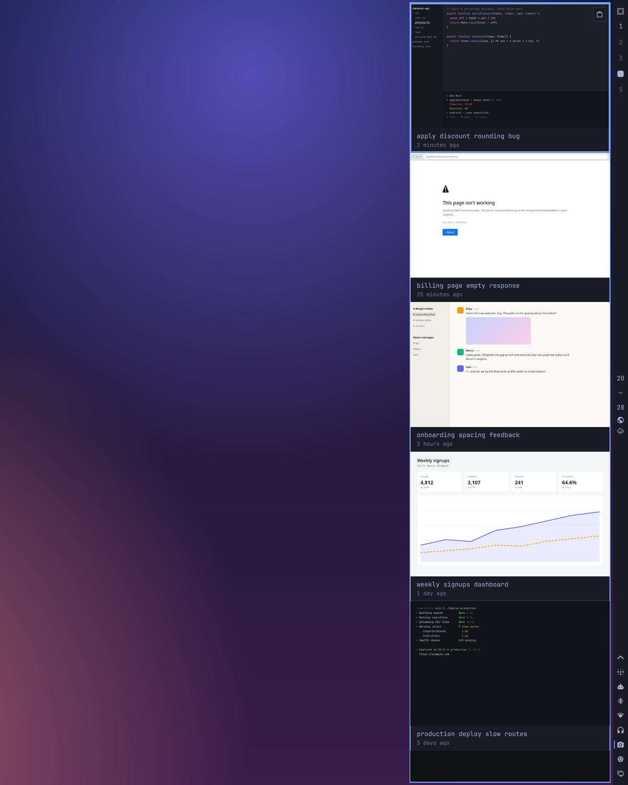

# Screenshots for the Omarchy bar

A full-height sidebar of your recent screenshots, opened from an icon in the
Omarchy bar. Search them by name, reopen one in Omasnap to annotate it, or
copy its path to paste into an editor or an agent session. It works with the
bar on any edge.



- **Type** as soon as it opens to filter by file name. Words can come in any
  order, and dashes and underscores are ignored, so `t3 error` matches
  `2026-11-18_07-36-12_t3-code-home-unavailable-error.png`.
- **Click** a screenshot, or press **Enter**, to reopen it in Omasnap's
  annotation editor (`omasnap --file <path>`).
- **Clipboard button**, **right-click**, **Ctrl+C** or **Shift+Enter** copies
  the file's absolute path (`wl-copy`).
- **↑/↓** and **PgUp/PgDn** move the selection. **Esc** clears the search,
  and a second Esc closes the sidebar.

Each screenshot shows its title (taken from Omasnap's
`<date>_<time>_<title>.png` file names) and how long ago it was taken. New
captures appear while the sidebar is open.

## Requirements

- [Omasnap](https://github.com/omacom/omasnap) (`omasnap`), Omarchy's
  screenshot tool, which ships with Omarchy. Clicking a screenshot runs
  `omasnap --file <path>`.
- `wl-copy` from `wl-clipboard` (also part of Omarchy), for copying paths.
- GNU `find`, used to list the screenshot folder.

## Install

```sh
omarchy plugin add https://github.com/jimjeffers/omarchy-snap-annotate --enable
```

Then add **Screenshots** to the bar from the bar settings if it doesn't
appear. To open the sidebar from a keybinding, bind it to:

```sh
omarchy-shell screenshots toggle
```

## Settings

| Setting | Default | |
|---|---|---|
| Screenshot folder | empty | Leave empty to use `$OMASNAP_SCREENSHOT_DIR`, then `$OMARCHY_SCREENSHOT_DIR`, then `~/Pictures/Screenshots` |
| Sidebar width | 380 | Width of the sidebar |
| Most screenshots listed | 400 | Only the newest this many are shown |

The plugin only reads the screenshot folder. It never changes or deletes
files, and it doesn't touch your configuration.

## Update

```sh
omarchy plugin update io.github.jimjeffers.snap-annotate
```

## Remove

```sh
omarchy plugin remove io.github.jimjeffers.snap-annotate
```

## Development

- Tests for the list logic: `node tests/model.test.js`.
- Check the plugin with `omarchy plugin validate .` before sending a change.
- English only for now; translations go in `i18n/<code>.json`.

## License

MIT
